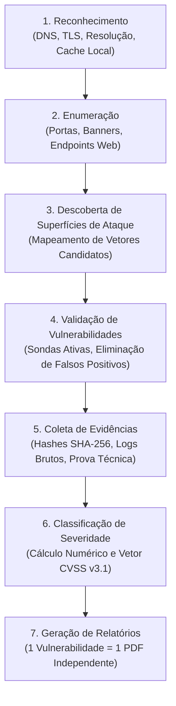

# 🔱 METATRON - Plataforma Autônoma de Auditoria de Segurança para Arch Linux

<p align="center">
  
  
  
  
  
  
</p>

---

## 📌 Sobre o METATRON

O **METATRON** é uma plataforma autônoma de auditoria de segurança cibernética projetada para operar nativamente em **Arch Linux**. 

Diferente de scanners convencionais ou assistentes que apenas geram hipóteses superficiais, o METATRON opera sob uma política rigorosa de **validação ativa e comprovação de evidências**. Nenhuma vulnerabilidade é registrada sem prova reproduzível e evidência técnica íntegra com checksum SHA-256.

---

## 🚀 Principais Capacidades

- 🗄️ **Persistência Local Completa em SQLite (`metatron.db`)**:
  - Memória de execução e contexto operacional
  - Resultados detalhados de varreduras e enumeração
  - Evidências brutas associadas a hashes criptográficos SHA-256
  - Vulnerabilidades validadas com métricas e pontuação CVSS v3.1
  - Catálogo de ferramentas do sistema e capacidades mapeadas
  - Histórico de instalações dinâmicas de ferramentas via pacman
  - Trilha cronológica de auditoria de ações executadas
  - Cache offline para reutilização de inteligência

- 📦 **Gerenciamento Inteligente de Ferramentas no Arch Linux**:
  - Verifica sempre se a ferramenta necessária já está instalada
  - Prioriza ferramentas pré-existentes no ambiente
  - Evita instalação redundante de ferramentas com capacidades já cobertas
  - Instalação sob demanda executada **exclusivamente via `pacman`**
  - **Não utiliza `yay`, `paru` ou outros AUR helpers**
  - Registro de toda instalação realizada no banco SQLite

- 🌐 **Operação Offline-First**:
  - Priorização de recursos locais e motores de análise nativos
  - Uso de rede externa apenas quando estritamente necessário para alcançar o alvo
  - Cache local persistido para consultas recorrentes

- 📄 **Relatórios Técnicos Individuais em PDF (1 Vulnerabilidade = 1 PDF)**:
  - Cada vulnerabilidade validada gera um arquivo PDF independente (`reports/METATRON_VULN_<id>_<slug>.pdf`)
  - Estrutura completa de reporte profissional:
    1. Título e cabeçalho executivo com carimbo de integridade
    2. Severidade qualitativa e badge visual padronizado
    3. Pontuação CVSS v3.1 oficial e decomposição métrica completa
    4. Descrição técnica e superfície de ataque analisada
    5. Passos exatos para reprodução independente
    6. Análise de impacto técnico e de negócio
    7. Evidências técnicas coletadas (PoC bruto com hash SHA-256)
    8. Correção recomendada detalhada e orientações de remediação
    9. Ferramentas utilizadas e trilha de auditoria

---

## 🔄 Processo de Auditoria em 7 Fases



### Critérios Estritos de Vulnerabilidade:
- **Não registrar hipóteses sem evidência.**
- **Não registrar potenciais vulnerabilidades sem validação.**
- **Priorizar achados estritamente reproduzíveis.**
- **Arquivar logs e evidências de suporte com integridade SHA-256.**

---

## 🛠️ Arquitetura do Sistema

| Módulo | Função |
|---|---|
| `metatron.py` | Ponto de entrada CLI interativo e painel de controle operacional |
| `audit_engine.py` | Motor de orquestração do ciclo de vida das 7 fases de auditoria |
| `db.py` | Camada de persistência local em SQLite com suporte WAL e 9 tabelas relacionais |
| `tool_manager.py` | Gerenciador de dependências Arch Linux via pacman nativo |
| `cvss.py` | Calculador oficial da especificação FIRST CVSS v3.1 (Base Score & Vector) |
| `export.py` | Gerador profissional de relatórios individuais em PDF com ReportLab |

---

## 📦 Instalação e Execução no Arch Linux

### 1. Clonar o repositório
```bash
git clone https://github.com/sooryathejas/METATRON.git
cd METATRON
```

### 2. Pacotes necessários no Arch Linux
```bash
sudo pacman -S --needed python python-reportlab curl bind openssl iproute2 iputils sqlite
```

### 3. Iniciar o METATRON
```bash
python metatron.py
```

---

## 💻 Exemplo de Execução e Saída

Ao auditar um alvo, cada vulnerabilidade com evidência validada gera um arquivo PDF independente no diretório `reports/`:

```text
=================================================================
🔱 METATRON :: AUDITORIA AUTÔNOMA DE SEGURANÇA NO ARCH LINUX
Alvo: http://127.0.0.1:8888 | Sessão SQLite: #3
=================================================================

[15:05:42] [RECONHECIMENTO] Iniciando reconhecimento do alvo: 127.0.0.1
[15:05:43] [ENUMERAÇÃO] Porta ABERTA encontrada: 8888 (HTTP-Alt)
[15:05:43] [SUPERFÍCIE DE ATAQUE] Total de superfícies identificadas para validação: 3
[15:05:43] [VALIDAÇÃO DE VULNS] VALIDADO: Ausência de proteção contra Clickjacking comprovada.
[15:05:43] [VALIDAÇÃO DE VULNS] VALIDADO: Ausência de X-Content-Type-Options comprovada.
[15:05:43] [VALIDAÇÃO DE VULNS] VALIDADO: Divulgação de versão confirmada: Server: BaseHTTP/0.6 Python/3.14.10
[15:05:43] [VALIDAÇÃO DE VULNS] VALIDADO: Método HTTP TRACE ativo confirmado com código 200.
[15:05:43] [VALIDAÇÃO DE VULNS] VALIDADO: Repositório Git (.git/HEAD) exposto publicamente!
[15:05:43] [COLETA DE EVIDÊNCIAS] Evidência arquivada (ID #1-#5)
[15:05:43] [CLASSIFICAÇÃO CVSS] Scores CVSS v3.1 calculados e persistidos no SQLite.
[15:05:44] [GERAÇÃO DE PDFS] Sucesso: 5 relatório(s) PDF independente(s) gerado(s) em 'reports/':
   📄 reports/METATRON_VULN_001_vulnerabilidade_de_clickjacking_devido___aus_ncia.pdf
   📄 reports/METATRON_VULN_002_aus_ncia_do_cabe_alho_de_prote__o_mime_sniffing__x.pdf
   📄 reports/METATRON_VULN_003_vazamento_de_informa__es_de_vers_o_do_servidor__se.pdf
   📄 reports/METATRON_VULN_004_m_todo_http_trace_habilitado__cross-site_tracing_-.pdf
   📄 reports/METATRON_VULN_005_exposi__o_cr_tica_de_reposit_rio_git_p_blico____gi.pdf

=================================================================
[+] AUDITORIA CONCLUÍDA
Total de vulnerabilidades validadas : 5
Total de PDFs independentes gerados : 5
=================================================================
```

---

## ⚖️ Licença e Responsabilidade

Este software foi desenvolvido para fins exclusivos de auditoria autorizada, testes de segurança defensiva e avaliação de conformidade técnica. O operador é inteiramente responsável pelo uso de acordo com a legislação vigente.
